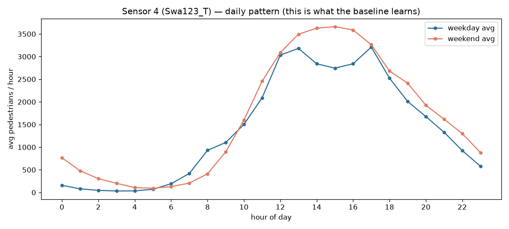

# Factory Pulse

**Sensor-fleet health monitoring** — ingest readings from a fleet of sensors,
learn each sensor's normal pattern, flag health problems (outages, flat-lines,
impossible values, duplicates, readings far from expected), show them on a map
dashboard, and generate a weekly health report. Validated with precision/recall.

Demonstrated on a **real public sensor network**: the City of Melbourne
**Pedestrian Counting System** (hourly counts from street sensors, plus sensor
locations).

> Built as a portfolio project by **Sanithma** (Mechatronics Engineering &
> Computer Science, Monash University). Built with AI assistance; all design,
> code and results were reviewed before use.

---

## The problem

An organisation running a fleet of sensors — pedestrian counters, factory-floor
IoT, environmental monitors — needs to know every day which sensors are
**healthy** and which are silent or lying. A sensor that has died, frozen on one
value, or is reporting impossible numbers quietly corrupts every dashboard and
decision downstream. Checking hundreds of sensors by hand does not scale.

Factory Pulse screens the whole fleet automatically, flags the unhealthy sensors
with evidence, and summarises the week for the people who act on it.

## Who it's for

Operations and maintenance teams (here, City of Melbourne staff) who must keep a
large sensor network healthy and trustworthy without inspecting each sensor by
hand.

## What it does

```
 Melbourne API ─▶ ingest ─▶ PostgreSQL ─▶ baseline ─▶ detect ─▶ map dashboard
                 (counts +   (store)      (expected   (health    + weekly
                  sensors)                 per slot)   rules)      AI report
```

1. **Ingest** hourly counts + sensor locations from the City of Melbourne API.
2. **Baseline** each sensor: the expected count by day-of-week and hour-of-day
   (median) and how variable each slot is (IQR).
3. **Detect** health issues → an `anomaly` table: **outage, flat-line,
   impossible value, duplicate, off-baseline**.
4. **Dashboard** (Streamlit + map): fleet overview, a live **map of sensor
   health**, per-sensor drill-down, and a downloadable issues table.
5. **Weekly report**: a local LLM writes a plain-English health report for
   council staff, from the computed numbers only.
6. **Evaluate**: precision / recall against injected known issues.

## Results & proof

**Real findings on the live Melbourne data** (6 months, 433k readings, 100
reporting sensors):

- **4,092 outages** detected — including **Collins Place South dead for 167
  hours** (~7 days) and several multi-day gaps.
- **10 flat-lined (stuck) sensors**.
- A 7-day sample report flagged a **21-hour outage at Southern Cross** and named
  the five sensors needing attention.

**The detectors are measured, not asserted.** Injecting 12 known issues into a
clean synthetic dataset and scoring by interval/timestamp match:

| rule | precision | recall |
|---|---|---|
| outage | 1.00 | 1.00 |
| flat-line | 1.00 | 1.00 |
| impossible value | 1.00 | 1.00 |
| duplicate | 1.00 | 1.00 |

Every injected issue found, zero false positives.

The seasonal baseline the detector learns (one sensor's weekday vs weekend daily
shape):



## How it works (tech)

**Python** (pandas, NumPy) · **PostgreSQL** on Neon via **SQLAlchemy** ·
**Streamlit + pydeck** (map) · City of Melbourne **Opendatasoft API** ·
**pytest** · a **local LLM** (Ollama).

**Schema** (`sql/schema.sql`, 3rd normal form): `sensor` (natural PK
`location_id`), `reading` (hourly facts, FK + index), `baseline` (expected per
sensor/weekday/hour), `anomaly` (CHECK on the five types).

## How to run

```powershell
python -m venv .venv
.venv\Scripts\Activate.ps1
pip install -r requirements.txt
copy .env.example .env     # add your Neon DATABASE_URL

python run_step1.py        # ingest + explore
python run_step2.py        # schema + load + baseline
python run_step4.py        # detection -> anomaly table
python run_step5.py        # evaluation: precision/recall
python run_step7.py        # weekly AI report
streamlit run app/dashboard.py
```

The weekly report runs on a **local** model: install [Ollama](https://ollama.com),
`ollama pull llama3.2`, and it upgrades from template to LLM prose automatically.
Without it, a template-filled draft is still produced.

## Testing

```powershell
pytest -q        # 13 tests, no database needed (synthetic data)
```

Covers each health rule (clean data, injected outage/flat-line/impossible/
duplicate, repeated-zero is not a fault, empty input), the baseline median, and
the precision/recall scorer.

## Limitations (honest notes)

- Evaluation uses **injected** issues on synthetic data: exact ground truth, but
  synthetic. The real-data findings (outages, flat-lines) are shown but not
  scored, since "unusual but real" has no crisp ground truth.
- The `off_baseline` rule is a tunable "unusual reading" flag, not a hard fault;
  thresholds would be set with the operations team.
- Thresholds (3-hour outage, 6-hour flat-line) are starting points to tune.

## Data & licence

- **City of Melbourne — Pedestrian Counting System** (hourly counts + sensor
  locations), open-data portal <https://data.melbourne.vic.gov.au>, City of
  Melbourne open data licence.
- Data pulls live in `data/` and are **not** committed (git-ignored).

## Built with AI assistance

This project was developed with AI assistance for design, code and
documentation. Every part was reviewed and tested before use. The health
detector and evaluation are the author's own method.
